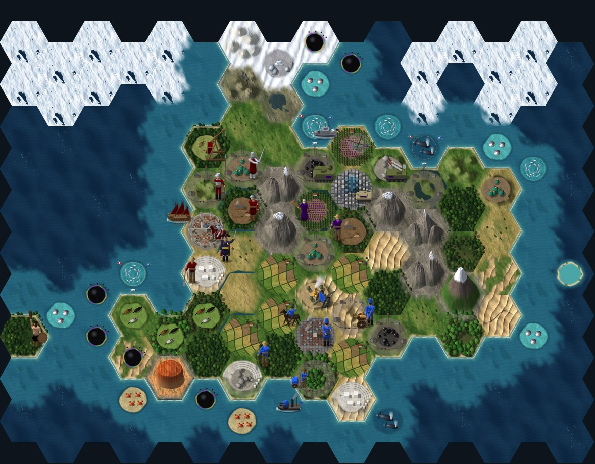
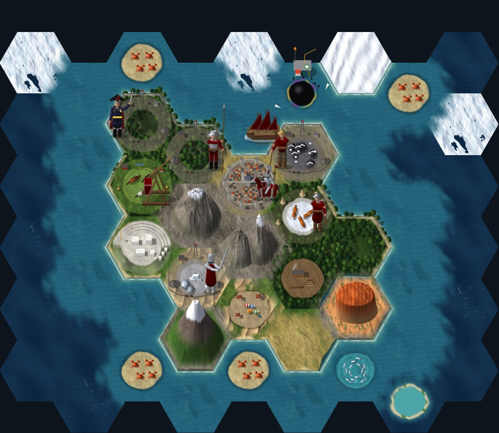
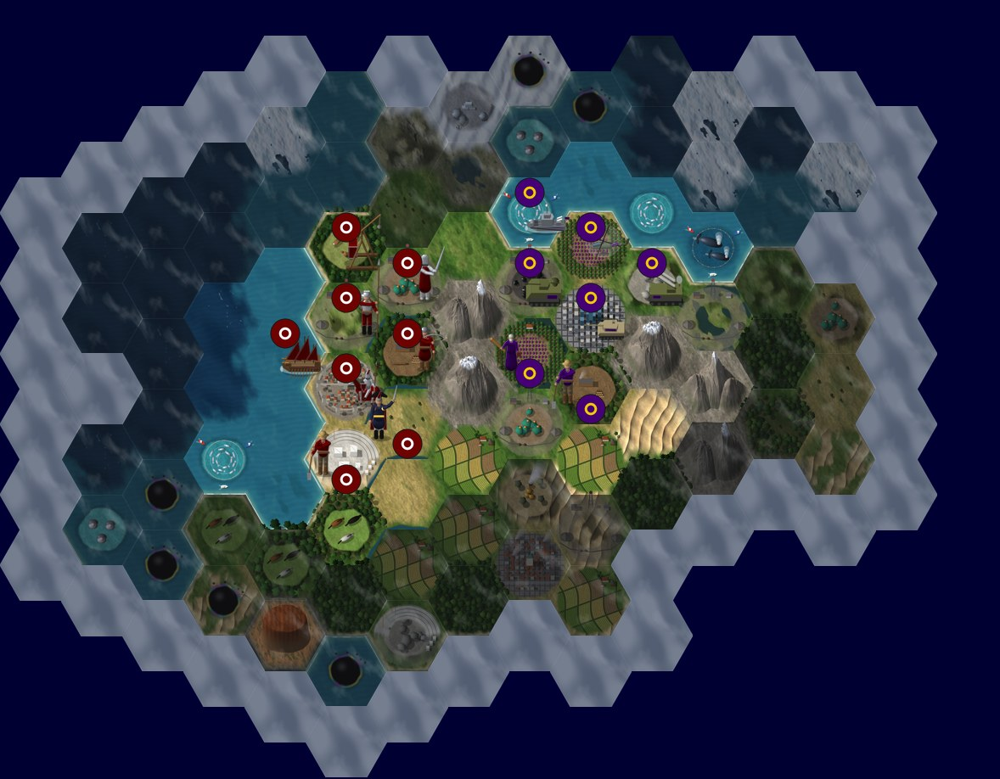
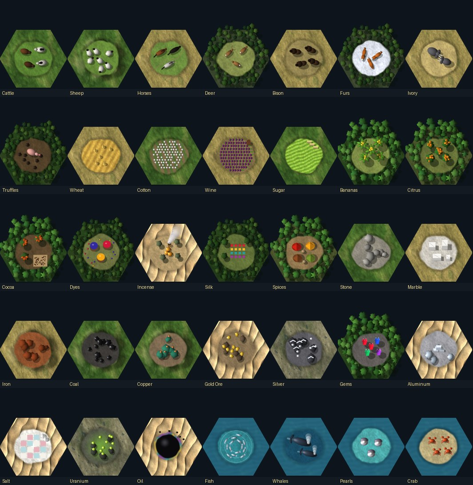
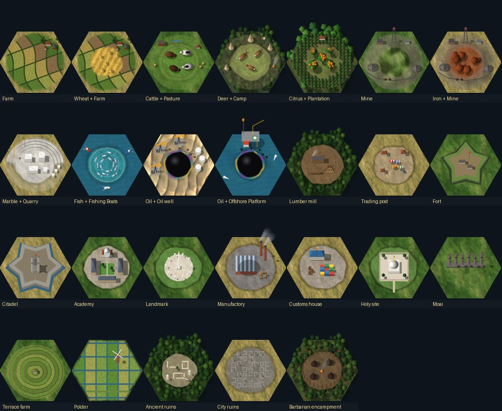
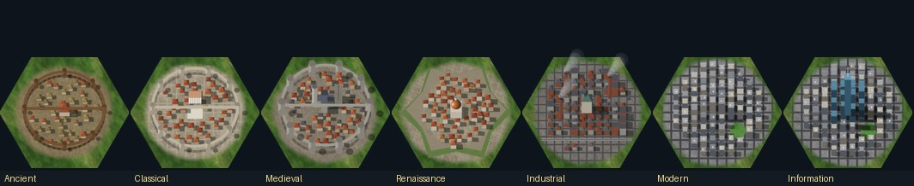
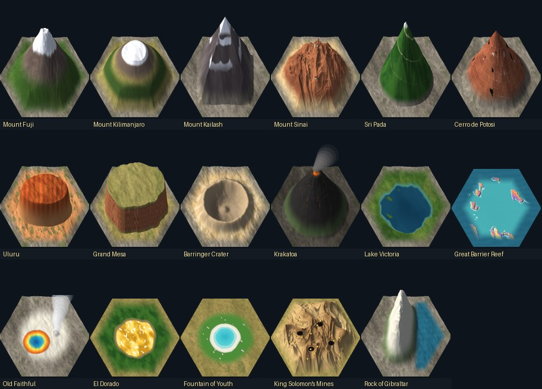
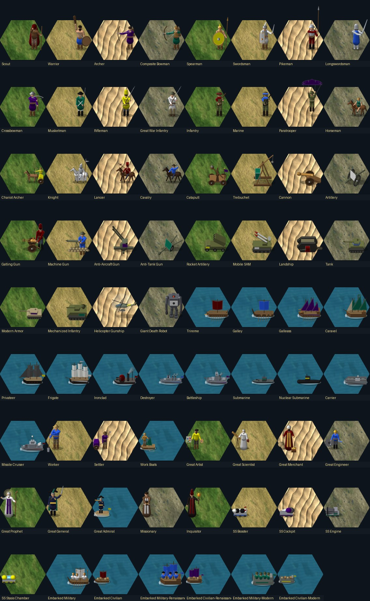

# Visual Hex Satellite

A tileset mod for [Unciv](https://github.com/yairm210/Unciv) that makes the map look like satellite imagery. It has hill-shaded terrain, mountains that rise above their tiles, and soft transitions where terrains meet. It also redraws resources, improvements, cities, natural wonders and every unit in the same style. Readability comes first: resources are drawn larger than life so each one is recognizable at a glance, and units carry their owner's colours.





As a player sees it, with fog of war and unit flags. Tiles you've seen but can't see now are darkened under thin wisps of mist, and a bank of fog marks the edge of the explored map:



*The previews and catalogs are made by `tools/preview_map.py`, which lays the images out using the same rules as the game. They aren't screenshots from Unciv, and the round unit flags are simple stand-ins for the game's own.*

## Install

1. In Unciv, open **Mods** and choose **Download mod from URL**. Paste `https://github.com/ryflan3/Visual-Hex-Mod` and choose **Download**.
2. Select **Visual Hex Mod** in the **Installed** column. Unciv ticks **Permanent audiovisual mod** by itself, but it doesn't load the mod's images yet. Untick the box and tick it again, which loads the images and saves the setting. If the box is empty, tick it once.
3. Leave the Mods screen and open **Options**, either from the main menu or from the menu during a game. On the **Display** tab, set **Tileset** to **Visual Hex Satellite**, and **Unitset** to **Visual Hex Satellite** for the units. Neither is chosen on the New Game screen. Keep **Show pixel improvements** on, or resources and improvements are hidden.

Unciv downloads the repository's default branch, and only works with public repositories.

To update the mod, download the same URL again, then close and reopen Unciv. Until it restarts, Unciv keeps showing the old images.

If **Visual Hex Satellite** isn't in the Tileset list, the mod's images didn't load. Check the checkbox in step 2 again. **Options → Locate mod errors** shows whether Unciv found a problem with the mod.

## Catalog

**Resources**, each on a terrain it normally appears on:



**Improvements**, alone and on the resources they work:



**City centres**, which change as their owner moves through the eras:



**Natural wonders:**



**Units**, each in a different nation's colours. Ships and boats are shown at sea:



## What's included

| Group | Images | Notes |
|---|---|---|
| Base terrain | 23 | Grassland, Plains, Desert, Tundra (3 versions each), Snow, Coast (2 each), Ocean (3), Lakes, Mountain (3) |
| Terrain features | 12 | Hill and Forest and Jungle (2 versions each), Marsh, Flood plains, Oasis, Ice, Atoll, Fallout |
| Rivers | 3 | `River-Bottom`, `River-BottomLeft`, `River-BottomRight` |
| Edge transitions | 135 | See below |
| Resources | 35 | Every resource that appears on the map |
| Improvements | 25 | Every buildable improvement, ruins and barbarian camps, plus a combined `Wheat+Farm` |
| City centres | 8 | Ancient, Classical, Medieval, Renaissance, Industrial, Modern and Information eras, plus a default |
| Natural wonders | 17 | All of the base game's wonders |
| Map overlays | 22 | Selection hex, highlight, crosshair, fog-of-war mist, unexplored-edge fog, 8 border pieces, 7 movement arrows, road, railroad |
| Units | 213 | 65 units and 6 boats for embarked units, each with two colour layers. See below |

All 493 images pack onto **two 2048×2048 texture sheets and one 2048×512 sheet**. That's about 48 MB of graphics memory including mipmaps.

Anything this tileset doesn't draw falls back to the built-in **HexaRealm** tileset. With the base game's rules that's nothing on the map itself. Units, resources, improvements or wonders added by other mods would come from HexaRealm.

### Units

The unit set is called **Visual Hex Satellite**, like the tileset, and is chosen separately under **Options → Display → Unitset**. It has every land unit, ship, civilian, great person and spaceship part in the base game:

* **Owner's colours.** Each unit has its owner's main colour on a large, easy-to-spot part: tunics and coats up to the First World War, shields, banners, crests and horse barding, sails, turret bands and hull stripes, and the canopy of the paratrooper. Later infantry wear realistic olive and camouflage, with the colour on a scarf, armband and helmet band. Unciv tints the `-2` layer of each unit image with the owner's outer colour. `-1` is an empty placeholder because the layers must be numbered from 1.
* **Placement.** Unciv draws a tile's unit flags in the middle of the hex, the military unit's in the upper half and the civilian's in the lower half. Military units stand on the right of the hex and civilians on the left, as in the HexaRealm units, so the flags don't cover them. Ships and vehicles are low, so they may reach under the military flag toward the middle.
* **Embarked units** sail in a longboat, a two-masted transport from the Renaissance and a landing craft from the Modern era. Military boats carry soldiers and civilian boats carry cargo.
* **Unique units** without their own image, such as the Legion or the Samurai, use the image of the unit they replace. That's how Unciv looks them up, so every civilization's army stays in the same style.
* **Aircraft and missiles** have no images. Unciv never draws them on the map; they're listed on their city's or carrier's flag instead.

### Edge transitions

Edge images are drawn on a tile when a neighbour on one side matches. File names follow Unciv's `Name-Origin-Destination-Direction` pattern.

| Set | Count | Drawn on | When the neighbour is |
|---|---|---|---|
| `Blend` | 60 | the lower-priority land terrain | another land terrain. All 10 pairs of Grassland, Plains, Desert, Tundra and Snow. The higher one spreads into the lower: Snow > Grassland > Plains > Tundra > Desert |
| `Shore` | 30 | each of those 5 land terrains | water. The beach is sand, gravel or ice depending on the terrain |
| `Scree` | 30 | each of those 5 land terrains | a mountain, or a natural wonder that turns into one |
| `Foam` | 6 | any water tile | land |
| `Shelf` | 6 | ocean | coast |
| `Cliff` | 3 | mountain | water to the south |

### Layout rules that keep tiles readable

Unciv draws a tile's resource first and its improvement on top of it. So:

* **Resources** sit in the middle of the tile on a cleared, contrasting patch with a soft drop shadow, so they stand out on any terrain, including forest and jungle. Each has its own colour and silhouette, and animals, fruit, crystals and nuggets are drawn much larger than life.
* **Ring improvements.** Improvements that only ever exist on a resource (pasture, camp, plantation, mine, quarry, fishing boats, oil well, offshore platform) are drawn as a ring around the middle and leave the centre clear. The resource under them stays visible, and the ring shows that it's being worked. Tall parts such as mine headframes and drilling rigs stand on the north side, because height is drawn upward on screen.
* **Farms** usually stand alone, so `Farm` covers the whole tile. `Wheat+Farm` keeps the wheat in the middle; Unciv uses that name when both are on the tile.
* **Natural wonders** replace the whole tile. Their outer edge uses the ground of the terrain the wonder turns into, which is what the neighbouring tiles' edge images blend toward.

## How the images are made

Every image is generated by Python scripts, using NumPy and Pillow. There's no hand-painted art, so you can change the look by editing a script and rebuilding.

* `tools/render_tiles.py` draws the terrain, features, rivers, edge transitions and map overlays.
* `tools/render_items.py` draws the resources, improvements, city centres and natural wonders, with the same light and projection.
* `tools/render_units.py` draws the units as small painted miniatures, built from shaded rods, balls, plates and boxes in the same light. It paints each unit's base image and its owner-colour layer together, so whatever stands in front of a coloured part also hides it in the colour layer. It measures each unit first and then sizes and places it, so nothing is cut off at the image edge.

How the images fit together:

* **Image shape.** Unciv draws each tile image at the hex's width, keeps its aspect ratio and anchors it at the bottom. The bottom 224×194 pixels of a terrain image are the hex. Anything taller, like mountains, tree crowns, towers and smoke, rises above the tile. Tiles lower on screen are drawn over the ones above. Edge images are 112×97, exactly the same aspect ratio, so they line up with the tiles to the pixel.
* **Seamless textures.** Every base texture repeats on the hex grid, so two neighbouring tiles of the same terrain continue each other. Alternate versions (`Grassland2`, `Grassland3`) only differ in the middle of the tile, so they join seamlessly too.
* **Blends.** A blend image paints the neighbour's own texture, which continues across the shared edge, and fades it out toward the tile centre.
* **Overlays.** The game can only fall back one tileset deep, and HexaRealm gets its overlays from FantasyHex. So this tileset includes its own overlays (borders, arrows, roads, the selection hex). They use the same geometry as the base game's pieces.

## Rebuilding

```bash
tools/build.sh             # render all images, pack the atlas, refresh the previews and catalogs
tools/build.sh Mountain    # only re-render images whose path contains "Mountain", then pack
```

You need Python 3 with `numpy` and `pillow`, plus Java 11 or newer. The script downloads the libGDX 1.14.2 texture packer (the version Unciv uses) into `.gdx/`. `tools/PackAtlas.java` packs with the same settings as Unciv's desktop packer: 2048 px pages, 8 px padding and mipmaps.

Android can't pack images on the device, so the packed `game.atlas`, `game.png`, `game2.png`, `game3.png` and `Atlases.json` are committed. The **Pack texture atlas** GitHub workflow repacks and commits them whenever files under `Images/` change.

## Known limitations

* **In-game testing.** This version was checked with the preview tool, not yet in Unciv itself.
* **Edge order.** Unciv draws edge images after terrain features, so a beach or blend along a forest tile's edge paints over the trees right at that edge. Fixing this needs a change in Unciv itself: drawing edge images before features.
* **Mountain cliffs.** Cliffs only appear on the south sides of mountains. On the north sides the mountain rises over the edge, and an edge image would paint across it.
* **Pillaged improvements.** There are no separate pillaged images, so the game shows the normal image with its red pillage tint.
* **Era changes.** Only city centres and embarked boats change with the era. Other improvements and units keep one look all game.
* **Unit poses.** Units have one pose each. Unciv doesn't animate unit images.

To list the mod in Unciv's in-game mod browser, add the `unciv-mod` topic to the GitHub repository.
